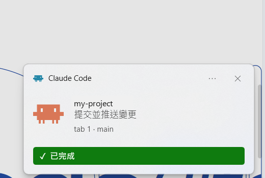

# herdr-notify-win

Turns Herdr notifications into native Windows toasts. When an agent (Claude Code, Codex, Antigravity) finishes or needs you, a toast shows which agent it was, the space, the task, and the tab and branch. Clicking it brings Herdr to the front and jumps to that terminal.



## How it works

- `mod/` is a Herdr mod (`win-toast`). It replaces Herdr's in-app toast and writes each notification as a JSON file to `%LOCALAPPDATA%\herdr-win-toast\spool`.
- `src/main.rs` builds `herdr-toast.exe`, which runs in the background. It watches the spool folder and shows a Windows toast for each file. A click reaches it through COM, so no new process is launched. It focuses Herdr and sends the toast's action to `herdr-app.sock`.
- `icons.ps1` draws each agent's logo with a status badge.

## Requirements

- Windows 10 or 11
- Herdr installed at `%LOCALAPPDATA%\Programs\herdr-app`
- Rust toolchain (`cargo`)

## Install

```powershell
.\install.ps1
```

The script:

1. Builds `herdr-toast.exe` and copies it to `%LOCALAPPDATA%\herdr-win-toast`.
2. Installs the mod into `%USERPROFILE%\.config\herdr-app\mods\win-toast` (or `$env:HERDR_APP_HOME` if set).
3. Registers one toast AppID per agent and the click handler under `HKCU:\Software\Classes`.
4. Adds a Startup shortcut so the exe runs at logon, then starts it.
5. Clones the `main` layout as `main-wintoast`, routes its notifications to `win-toast`, and switches to it.

Run it again to update.

## Uninstall

Switch Herdr back to the `main` layout, then remove:

- `%APPDATA%\Microsoft\Windows\Start Menu\Programs\Startup\herdr-win-toast.lnk`
- `%LOCALAPPDATA%\herdr-win-toast`
- `%USERPROFILE%\.config\herdr-app\mods\win-toast`
- `HKCU:\Software\Classes\AppUserModelId\Herdr.Notify*`
- `HKCU:\Software\Classes\CLSID\{F284B6D9-7D6B-4119-9170-D8A75506F3FA}`
